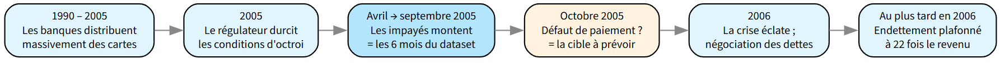
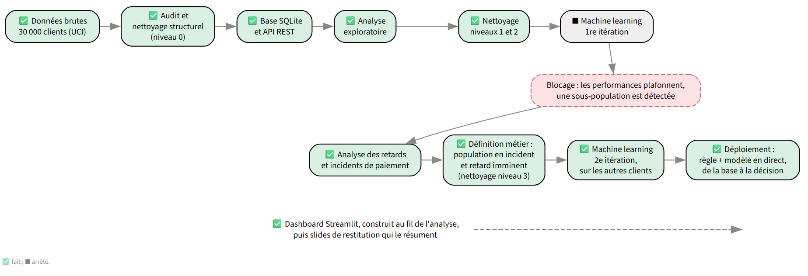

<p align="center"></p>


🌐 **Le site du projet : [risklens-ml.streamlit.app](https://risklens-ml.streamlit.app/)**. Chaque graphique et chaque chiffre y est recalculé en direct sur les données.

## 📌 Présentation de mon projet de fin de bootcamp
**RiskLens ML** est une mission Data & IA complète visant à transformer des données transactionnelles historiques en un outil d'aide à la décision pour la gestion du risque crédit.
Durée prévue : 7 semaines à partir du 30 août  

Le projet suit un cycle de vie data complet : du diagnostic initial et la structuration d'une base de données relationnelle, à l'exposition des données via une API, jusqu'à la création d'un modèle prédictif et d'un dashboard interactif sous Streamlit.

### 🎯 Problématique
> **"Peut-on prévoir le défaut de paiement d'un client en se basant uniquement sur son comportement transactionnel des 6 derniers mois, malgré un manque d'informations économiques globales ?"**

L'enjeu est de déterminer si les habitudes de paiement et l'utilisation du crédit ainsi que les informations de base d'un client sont des indicateurs suffisamment robustes pour anticiper un défaut, sans deux types d'informations que les banques utilisent d'habitude : les **données de conjoncture** (chômage, inflation, croissance) et les **données économiques du client lui-même** (revenu, autres crédits, loyer, endettement total, reste à vivre), ni score de crédit externe.

### 💥 Le contexte : la crise des *"Card Monsters"* (Taïwan, 2005)
- **L'économie allait bien** : chômage bas, inflation maîtrisée, croissance solide. La crise ne vient pas de l'économie.
- **Les banques ont distribué des cartes sans compter** : 133 cartes pour 100 adultes en 2005, avec des critères d'octroi abaissés et des taux de 17 à 20 % par an, au plafond légal. Beaucoup de clients ne pouvaient plus payer que le minimum chaque mois : on les a surnommés les « esclaves de la carte ».
- **Des clients payaient une carte avec une autre**, en multipliant les cartes dans des banques différentes : c'est la « cavalerie ».
- **En 2005, le régulateur durcit les conditions d'octroi** : la « cavalerie » se grippe et les impayés augmentent fortement au second semestre 2005, avant que la crise n'éclate au grand jour en 2006. **Le dataset couvre avril à septembre 2005, au moment où la vague monte.**


*Les étapes de la crise des cartes de crédit à Taïwan et la place du dataset. Sources détaillées dans la chronologie du [document de contexte](docs/contexte.md).*

### 📚 Le dataset et l'étude de référence
Ce dataset est la base de données publique qui résulte de [l'étude scientifique de I-Cheng Yeh et Che-hui Lien (2009)](https://bradzzz.gitbooks.io/ga-dsi-seattle/content/dsi/dsi_05_classification_databases/2.1-lesson/assets/datasets/DefaultCreditCardClients_yeh_2009.pdf) (résumé en français [ici](docs/resume_yeh_lien_2009.md)). En pleine crise, une banque taïwanaise a confié aux chercheurs un échantillon anonymisé de 30 000 clients. Cette étude comparait plusieurs modèles pour repérer les clients à risque. Le meilleur, un réseau de neurones, obtenait un score de 0,54, ce qui correspond à un **AUC de 0,77**. L'AUC mesure la capacité d'un modèle à distinguer les bons payeurs des futurs défaillants.

Ma démarche adopte un prisme résolument **orienté métier**. En combinant une compréhension approfondie du jeu de données (le fonctionnement de la banque, de ses codifications et des paiements de l'époque), un nettoyage rigoureux fondé sur des règles métier et une exigence posée avant tout modèle, un **taux de rappel minimal** (le modèle du projet doit trouver au moins une part fixée des défauts), je cherche à optimiser la détection réelle des risques de défaut, garantissant ainsi une performance robuste et réellement actionnable pour la gestion des risques bancaires.

**🚀 Objectif ML Engineer :** Mon but est de dépasser le score de référence de l'étude de 2009 (un AUC de 0,77). En banque, oublier un client à risque (Faux Négatif) coûte bien plus cher que de suspecter un client sûr (Faux Positif).

---

## 🔎 Ce que l'analyse montre
L'analyse est terminée, du nettoyage au déploiement. Voici ses conclusions :
- **Les données** : 30 000 clients d'une banque taïwanaise, suivis d'avril à septembre 2005, en pleine crise des cartes de crédit. 22,1 % font défaut en octobre, un taux bien plus élevé que celui d'un portefeuille bancaire ordinaire.
- **La base de données et l'API** : les données sont rangées dans une base relationnelle et exposées par une API REST, comme dans le système d'information d'une banque.
- **Comprendre le jeu de données** : un fichier complet, mais des anomalies à expliquer avant toute analyse. Les codifications de paiement ne sont pas un fait brut : c'est une étiquette de la banque, qui juge la facture d'un mois sur le paiement fait le mois suivant. La banque se montre plus souple d'avril à juin qu'à partir de juillet, et la codification 1 de septembre attend un paiement d'octobre absent du dataset : les deux sont corrigées au nettoyage. Très peu de lignes sont retirées (4 paiements géants, 941 comptes inactifs, 204 plafonds atypiques) : il reste 28 851 clients.
- **L'analyse exploratoire** : le profil des clients ne pèse que modérément sur le risque ; ce sont les comportements qui comptent. Un client qui ne rembourse rien fait défaut à 58 %, un payeur au comptant à 15 %. La dette totale des clients augmente de 32 % en six mois, alors qu'ils n'en remboursent chaque mois que 11 à 12 %. Et le risque grimpe avec les codifications de retard accumulées : de 11 % sans aucune à 70 % pour un retard sur les six mois.
- **La population en incident** : des clients figés en retard et un modèle qui plafonnait ont conduit à isoler une sous-population par une **règle métier explicable** : deux codifications de retard d'affilée, ou une seule de 3 ou plus. Sur des clients jamais vus, elle ne retient que 14 % des clients, mais 60 % d'entre eux font défaut, et elle capte 37 % des défauts, sans aucun modèle. Le **retard imminent**, défaut d'octobre déjà codifié par la banque, est mis à part : ensemble, les deux populations réunissent 17 % des clients et 48 % des défauts.
- **Le machine learning** : sur les autres clients, tous les modèles et toutes les variables atteignent le même plafond. Le modèle retenu, qui ne garde comme donnée démographique que le niveau d'études, range les clients par niveau de risque, du très haut risque (environ quatre clients sur dix en défaut de paiement) au risque faible (moins d'un sur dix). Environ un quart des défauts de paiement de ces clients ont le profil des bons clients et ne s'annoncent pas dans les données.
- **Le déploiement** : la règle puis le modèle tournent en direct, de la base de données à la décision, sur des clients jamais vus, et retrouvent les résultats de l'évaluation.
- **La réponse** : oui, en partie. Une analyse métier, tirée par les codifications de la banque relues avec les paiements, prévoit près de la moitié des défauts de paiement sans aucun modèle ; un modèle fondé principalement sur le comportement de paiement classe ensuite les autres clients par niveau de risque, pour repérer une partie des défaillances que la banque ne voit pas venir ; le reste ne s'annonce pas dans les données. Le tri atteint un AUC d'environ 0,78 sur le même fichier que l'étude, et d'environ 0,79 pour le système du projet sur ses clients de test, contre 0,77 pour l'étude de 2009 : défi relevé, de peu.

Détails : [journal du machine learning](lab_ML/tableau_ML.md), [méthodologie](lab_ML/methodologie_ML.md), [hypothèses et conclusions](docs/hypotheses_et_conclusions.md).

#### 🕵️‍♂️ Pour aller plus loin : Les coulisses de la donnée

Pour découvrir comment des détails logistiques de l'époque (comme les règlements en espèces dans les supérettes 7-Eleven, qui créent des décalages dans l'enregistrement des paiements sur les comptes, et des erreurs de saisie) ou les parallèles avec le **Buy Now, Pay Later (BNPL)** actuel éclairent ce projet d'un point de vue purement métier :
📖 [Lire le contexte du projet](docs/contexte.md) · 📚 [Toutes les sources du projet](docs/sources.md)

---

## 🛠️ La démarche du projet


Le schéma résume le parcours ; voici le détail de chaque étape, dans le même ordre, avec ses notebooks et ses fichiers.

#### 1. Données brutes, audit et nettoyage structurel
*   Analyse du dataset *Default of Credit Card Clients* (30 000 clients, UCI), formulation de la problématique et identification des limites (manque de données contextuelles).
*   Audit et nettoyage structurel (niveau 0) : [notebook d'audit](src/01_01_audit.ipynb) | sens de chaque variable : [dictionnaire des données](docs/dataset_dictionary.md)

#### 2. Base SQLite et API REST
*   Modélisation relationnelle : [schéma de la base](images/schema_bdd__risklens.png) | schéma SQL normalisé, avec des tables de correspondance qui traduisent les valeurs numériques en libellés explicites : [script de création des tables](src/03_02_creation_tables.sql)
*   Chargement des données dans la base : [script d'ingestion](src/03_01_ingestion_donnees.py) | contrôle de cohérence de la base face au fichier : [notebook de test](src/03_03_test_coh%C3%A9rence.ipynb)
*   API avec **FastAPI** : les 4 types d'opérations **CRUD** (Create, Read, Update, Delete), pour accéder aux données et les gérer sans accès direct à la base : [fichier API](src/04_01_api.py)

#### 3. Analyse exploratoire et nettoyage (niveaux 1 et 2)
*   Analyse statistique approfondie (corrélations, tendances) avec Python : [EDA laboratoire](src/05_01_EDA_lab.ipynb)
*   Nettoyage par niveaux cumulatifs, chaque correction justifiée par la logique métier : [notebook de nettoyage](src/02_01_nettoyage.ipynb)
*   Data visualisation pour identifier les facteurs clés du défaut de paiement : [EDA storytelling](src/05_03_EDA_storytelling.ipynb)
*   Colonnes créées pendant l'exploration, une seule définition par colonne : [colonnes créées](docs/colonnes_creees.md)

#### 4. Machine learning, 1re itération, et le blocage
*   Premiers modèles sur tout le dataset, population en incident comprise, à chaque niveau de nettoyage : [archive de la première itération](lab_ML/1ere_iteration/) et son [journal](lab_ML/1ere_iteration/tableau_ML.md).
*   **Le blocage** : les performances plafonnent, et une sous-population de clients figés en retard apparaît. L'itération est arrêtée ; son archive est gardée telle quelle, comme trace des performances de référence.

#### 5. La population en incident : analyse et définition métier
*   Population en incident, isolée par une règle métier (deux codifications de retard d'affilée, ou une seule de 3 ou plus), et retard imminent mis à part (un premier retard posé par la banque en septembre, après un mois d'août sain) : [EDA incidents](src/05_02_EDA_incidents.ipynb)
*   Étude dédiée de la codification `PAY_n = 1` (codification d'attente du paiement d'octobre) et sa correction, avec trois modèles qui estiment les sorties du retard à l'unanimité : [EDA codification 1](src/05_04_EDA_codification1.ipynb), [modèles des sorties du retard](src/02_02_modele_sorties_retard.ipynb)
*   Codifications 1 remplacées (niveau 2), retards d'avril à juin uniformisés, puis statuts et indicateurs de la population en incident (niveau 3) : [notebook de nettoyage](src/02_01_nettoyage.ipynb)

#### 6. Machine learning, 2e itération, sur les autres clients
*   Modèles entraînés sur les clients qui ont une dette en septembre, **sans la population en incident ni le retard imminent** (confiés aux règles métier), avec un découpage entraînement / test propre au machine learning : [création des jeux](lab_ML/creation_datasets_ML.ipynb).
*   Six modèles comparés à chaque scénario (régression logistique, SVM, KNN, réseau de neurones, RandomForest, CatBoost), cinq gardés pour l'entraînement final (sans RandomForest), réglés par une **boucle automatique de GridSearch** sous contrainte de surapprentissage, en validation croisée à 5 plis ; réglage sur la **précision des défauts prédits** au rappel minimal (60 % des défauts), classement par le score décisionnel F2.
*   Variables ajoutées par scénarios, puis élaguées ; chaque scénario comparé à sa référence pli par pli, les écarts serrés tranchés par une validation croisée répétée : [journal des scénarios](lab_ML/tableau_ML.md).
*   Ce qui fait encore varier le défaut de paiement chez les clients du machine learning, et deux contrôles de la cible (clients sans dette, clients en incident qui paient) : [EDA de la population du ML](lab_ML/eda_population_ml.ipynb).
*   **Comparatif global**, essai à part : modèles sur les 23 variables d'origine, avec ou sans séparation des deux populations des règles métier, et niveaux de risque de toutes les approches sur la même courbe : [essais du comparatif](lab_ML/comparatif_global/).
*   **Version finale** (`ml_17`) : 21 variables, le niveau d'études pour seule donnée démographique, CatBoost ; lue **une seule fois** sur le jeu de test, qui confirme la validation : [évaluation finale](lab_ML/evaluation_finale_test.ipynb).
*   **Limites** : analyse des défauts que les modèles manquent et de la cible elle-même : [méthodologie, section 13](lab_ML/methodologie_ML.md).

#### 7. Déploiement : la règle et le modèle en direct
*   Les deux règles métier puis le modèle tournent en direct sur le site, de la base de données à la décision, sur des clients que le modèle n'a jamais vus. Le nettoyage est refait en mémoire, dans l'application : la base n'est jamais modifiée.
*   Trois démonstrations : sur les données du projet ; sur les données brutes lues dans la base par l'API, nettoyage refait en direct ; sur tout le dataset d'origine, avec un modèle entraîné sur les données brutes et 9 niveaux de risque : [préparation des démos 1 et 2](lab_ML/demo_ML/creation_demo_ML.ipynb), [préparation de la démo 3](lab_ML/demo_ML/creation_demo_3.ipynb).
*   L'API s'enrichit d'une lecture par lot (`POST /clients/lot`) et des prédictions enregistrées dans la base (`GET /prediction/{client_id}`).

#### 8. Dashboard Streamlit et slides de restitution
*   Dashboard interactif sous **Streamlit**, construit au fil de l'analyse : chaque graphique et chaque chiffre est recalculé en direct sur les données : [accéder au site](https://risklens-ml.streamlit.app/)
*   Application : [routeur](src/04_02_streamlit_app.py), une page par sous-partie dans [`src/streamlit_pages/`](src/streamlit_pages/), code partagé dans [`commun.py`](src/streamlit_pages/commun.py).
*   Slides de restitution, qui résument le site pour une présentation orale à un public non technique.

---

## 📋 Pilotage du projet
Le suivi rigoureux de la mission est assuré via un tableau **Trello**, mis à jour hebdomadairement pour monitorer l'avancement des étapes et le respect du planning.
*   [lien Trello](https://trello.com/b/OKlbbtCy/risklens-ml)

---

## 🌐 Architecture & Accès en Ligne

Le projet est entièrement déployé dans le cloud selon une architecture découplée (API Backend + Interface Frontend) :

* **🖥️ Interface Utilisateur (Frontend Streamlit) :** [Accéder au site](https://risklens-ml.streamlit.app/)
* **⚙️ Documentation Technique (Backend FastAPI / Swagger UI) :** [Explorer l'API et les routes](https://risklens-ml-api.onrender.com/docs)
* **🤖 Modèles :** enregistrés dans le dépôt ([`lab_ML/demo_ML/`](lab_ML/demo_ML/)), chargés et exécutés par l'application Streamlit ; deux des trois démonstrations lisent les clients dans la base par l'API.
* **🗄️ Base de données :** SQLite, hébergée avec l'API ; elle contient aussi les prédictions enregistrées du modèle entraîné sur les données brutes. Les démonstrations ne font que la lire.

### 🧪 Fonctionnalités à tester sur le site
**La base de données, par l'API**
* **Consultation (GET)** : Requêter les profils clients et leurs historiques de paiement issus de la BDD SQLite.
* **Opérations CRUD (POST / PATCH / DELETE)** : Simuler l'ajout, la modification ou la suppression de dossiers clients en direct.
* **Validation des schémas JSON** : Inspecter la structure des requêtes et les modèles de données (Pydantic).

**Les simulateurs de risque par profil**
* Choisir un profil de client (âge, genre, niveau d'études, statut marital) et lire son taux de défaut de paiement : sur tous les clients étudiés, sur la base lue par l'API, sur la population en incident et le retard imminent, et sur les clients confiés au machine learning.

**Les démonstrations du modèle**
* **Le système en direct** : injecter un lot de clients que le modèle n'a jamais vus, choisir la part des défauts à détecter (ou les règles métier seules), puis comparer les décisions au défaut constaté ; ou suivre un client, de sa lecture dans la base jusqu'à son niveau de risque.
* **Lecture par lot et prédictions (`POST /clients/lot`, `GET /prediction`)** : lire des milliers de clients en un appel, consulter la prédiction enregistrée d'un client.

> ℹ️ *L'API est hébergée sur l'offre gratuite de Render. Si le serveur est en veille, la première requête peut prendre jusqu'à une minute à répondre.*

---

## ⚙️ Installation
1. **Cloner le dépôt** :
   ```bash
   git clone https://github.com/johan-mac-59/RiskLens_ML
   cd RiskLens_ML
   ```
2. **Installer les dépendances** (via `uv`) :
   ```bash
   uv sync
   ```
3. **Configuration des données** :
   Téléchargez le dataset depuis [Kaggle](https://www.kaggle.com/datasets/mariosfish/default-of-credit-card-clients/data) et placez le fichier CSV dans le dossier `data/raw/`, sous le nom `default of credit card clients.csv` (le nom attendu par `src/02_01_nettoyage.ipynb`).
   Pour reproduire le machine learning : exécuter `src/02_01_nettoyage.ipynb` en entier, puis `lab_ML/creation_datasets_ML.ipynb`, puis les scénarios `lab_ML/ml_0.ipynb`, `ml_1`… dans l'ordre (détail : section 0 de [`lab_ML/methodologie_ML.md`](lab_ML/methodologie_ML.md)).

---

## 🛠️ Stack Technique
* **Langage :** Python (Pandas, NumPy, Uvicorn, Requests)
* **Base de données :** SQLite (Modélisation relationnelle, Foreign Keys)
* **API & Backend :** FastAPI, Pydantic (Validation des schémas JSON, Opérations CRUD, Documentation Swagger UI)
* **Déploiement Cloud :** Render (API Web Service), GitHub (Gestion de versions & Intégration continue)
* **Gestionnaire de paquets :** `uv` (`pyproject.toml`)
* **Data visualisation :** Plotly, Streamlit (dashboard interactif)
* **Machine Learning :** Scikit-Learn, CatBoost
* **Front-end / UI :** Streamlit Cloud

---

## 🔭 Recommandations et axes d'amélioration

Aucune banque n'utilise ce travail : il montre une méthode et ce qu'on peut en attendre.

**Pour une banque : les règles d'abord, le modèle ensuite, l'humain toujours**
1.  **Appliquer d'abord les deux règles métier**, la population en incident et le retard imminent. Simples, explicables, sans modèle, elles repèrent près de la moitié des défauts de paiement, avec environ six prédictions justes sur dix. Les clients en incident qui recommencent à payer méritent un examen au cas par cas : ce sont eux, les fausses alertes des règles.
2.  **Réserver le modèle aux autres clients, et l'utiliser par niveaux de risque.** Traiter d'abord le très haut risque, puis le haut risque. Vu du portefeuille entier, le risque modéré est moins risqué que le client moyen : le signalement s'y arrête, ou se règle selon la capacité des équipes et le coût réel d'une fausse alerte face à un défaut de paiement manqué.
3.  **Garder une décision humaine.** Le niveau de risque est un outil interne, pour prioriser la surveillance ; il ne se communique pas au client et ne décide seul d'aucune mesure qui le touche. C'est aussi ce qu'impose le droit.
4.  **À score égal, choisir le modèle le plus simple**, et le plus facile à justifier devant la gestion des risques ; et se passer des données démographiques qui n'apportent rien au score : l'âge, le genre et le statut marital ont été retirés sans perte.
5.  **Réapprendre sur des données récentes et suivre le modèle dans le temps** : mesurer chaque mois le taux de défaut de paiement de chaque niveau, et réapprendre quand il s'écarte de ce qui était attendu.

**Pour aller plus loin : quatre informations à obtenir de la banque**, car les limites du projet viennent des données :
*   **La définition exacte du défaut de paiement noté par la banque** : impayé observé, ou statut posé par la banque ? C'est la condition de toute amélioration.
*   **Les vrais encours** : le montant du relevé ne serait pas toujours la dette réelle ; on saurait alors si les défauts de paiement des clients « sans dette » sont une erreur de la cible ou une dette invisible dans les relevés.
*   **La liste des clients suivis hors du circuit normal** (recouvrement, contentieux) : elle validerait les deux règles métier, et séparerait le défaut « administratif » du vrai impayé. Elle dirait aussi ce que sont les défauts de paiement que rien n'annonçait, chez des clients au profil de bons payeurs (environ un quart des défauts de paiement des autres clients) : de vrais impayés, ou des statuts posés par la banque pour des raisons que les données ne montrent pas.
*   **La façon dont l'échantillon a été tiré** : avec environ un client sur cinq en défaut de paiement, il ne ressemble pas à un portefeuille réel. Savoir quels clients ont été retenus dirait si les clients ordinaires, qui paient sans incident, ont été en grande partie écartés, ce qui changerait à la fois les taux affichés et ce que les modèles ont pu apprendre.

**Les pistes ouvertes**
*   **Une probabilité de défaut de paiement par client** (calibration), l'objectif principal de l'étude de 2009, plutôt qu'un taux par niveau de risque ; on pourrait alors comparer le projet à l'étude sur son propre terrain.
*   **Sortir quelques clients des populations à risque.** Avec l'exigence retenue (ne sortir un client que s'il a au moins neuf chances sur dix de payer, car sortir à tort un client qui sera en défaut de paiement revient à abandonner une créance), aucun modèle ne trouve de client à sortir : dans ces populations, ils trient à peine mieux que le hasard. Une autre voie serait de demander l'**accord de plusieurs modèles de familles différentes**, comme pour la correction des codifications 1, pour sortir peu de clients, mais avec une grande sûreté ; les clients sortis seraient déclarés sans défaut de paiement, sans repasser par le modèle. Deux conditions : une exigence fixée à l'avance par le métier, jamais réglée sur le résultat, et un jugement sur l'entraînement seul, le test de ces populations ayant déjà été lu.
*   **Mieux corriger les codifications 1 de septembre.** Les trois modèles qui les tranchent n'utilisent que les codifications, les soldes, les paiements et le plafond. Des variables construites (ratios de paiement, utilisation du plafond), validées pour ce problème, pourraient les aider. Mais une seule codification changée touche tout le circuit en aval, du nettoyage au découpage du machine learning, et le test a déjà été lu : c'est une piste pour une nouvelle version du projet, avec un nouveau test. Seule la banque, enfin, peut confirmer la lecture retenue, celle d'une codification temporaire posée le temps de trancher.

**Les pistes envisagées puis écartées**
*   **Combiner plusieurs modèles** (vote, moyenne des probabilités) : les cinq modèles de la version finale se partagent les clients de la même façon ; sur 620 défauts de paiement analysés, 305 sont trouvés par les cinq à la fois, et 154 par aucun ([analyse des défauts manqués](lab_ML/analyse_defauts_manques.ipynb)). Les combiner ne ferait pas apparaître les défauts de paiement qu'aucun ne voit.
*   **Ajouter encore des variables** : toutes les variables construites pendant l'exploration, ajoutées ensemble puis retirées famille par famille, sont restées dans l'incertitude de la mesure.
*   **Des modèles plus réglés** : des réglages élargis ne font pas mieux, et un modèle lancé sur les données brutes fait jeu égal avec le projet sur les mêmes clients.
*   **Nettoyer davantage les données** selon des règles métier : au-delà de ce que les paiements permettent de trancher, ce serait transformer les données en notre propre lecture ; les codifications traduisent un signal de la banque, qu'on ne voit pas.
*   **Recoder la cible** : les modèles prédiraient alors notre définition du défaut de paiement, et non plus celle de la banque ; ce serait changer la question.
*   **Changer de jeu de données**, pour un jeu à la cible clairement définie et aux codifications documentées : le pari était de faire mieux en lisant ces données avec un regard métier, en comprenant les codifications de la banque et le fonctionnement de ses comptes avant de modéliser. Il a payé en partie, avec la population en incident et le retard imminent, isolés par des règles métier qui prédisent à elles seules près de la moitié des défauts de paiement. Ce dataset est aussi celui de l'étude de référence : en changer, c'était renoncer à s'y comparer.
*   **Réentraîner le modèle sur l'entraînement et le test réunis** : le gain attendu reste dans le bruit, et il ne resterait plus de clients jamais vus pour juger le modèle et le montrer en direct.

Raisonnement complet : page « Les recommandations » du [site](https://risklens-ml.streamlit.app/) et [hypothèses et conclusions](docs/hypotheses_et_conclusions.md).

---

☕ Le projet vous a plu ? [Offrez-moi un café](https://buymeacoffee.com/johan_mac)
